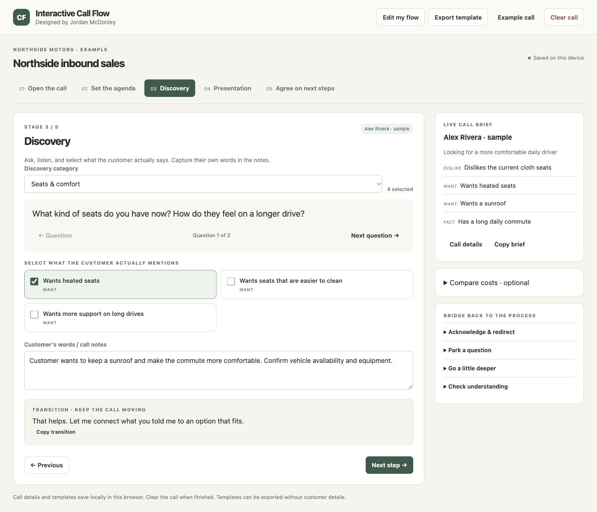
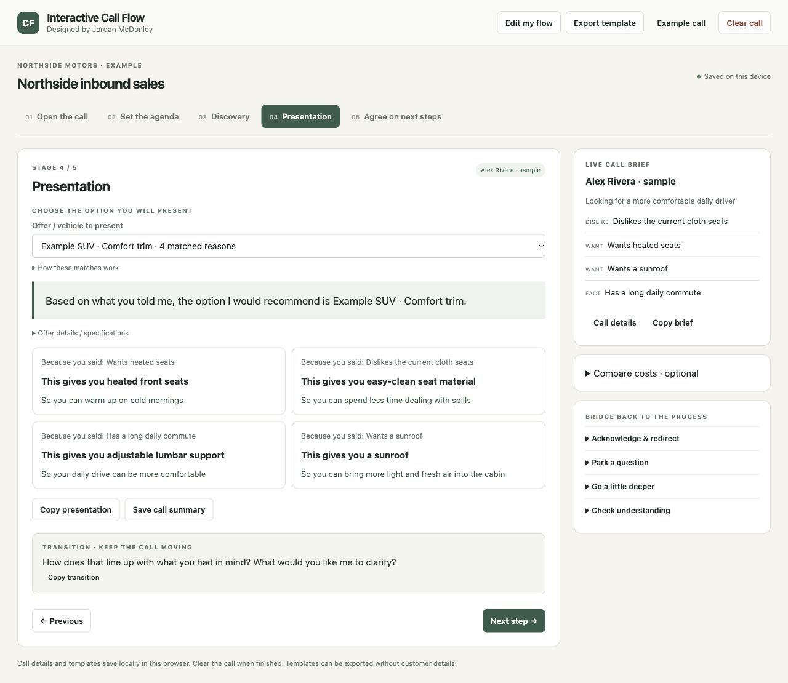

# Interactive Call Flow

**Your sales process, made usable during a real conversation.**

A local-first call workspace by Jordan McDonley. Start with an editable dealership or home-connectivity example, or write your own flow. Guide the call with transitions, capture what the customer wants, likes, and dislikes, then connect those discoveries to a specific offer’s features and benefits.

This is a functional app rebuilt from Jordan’s original Interactive Call Flow workbook. It is not a spreadsheet viewer or a screenshot mockup. The hosted app and the downloadable HTML contain the same code.

## Use it locally — no coding required

1. Open [Releases](https://github.com/dkm90x/interactive-call-flow/releases/latest).
2. Download **interactive-call-flow.html**. Download the file rather than saving the GitHub preview page.
3. Double-click the downloaded file and open it in a current desktop Chrome, Edge, Firefox, or Safari browser.
4. Choose a starting template. **Try an example call** uses clearly fictional details so you can explore the workflow.
5. Open **Edit my flow** to replace the example information with your business’s process. Click **Save changes**.

No installation, account, subscription, API key, build step, or internet connection is required for the downloaded file. This is a browser-based local app, not a signed native Mac/Windows executable.

**Try it online:** [Interactive Call Flow](https://jordan-interactive-call-flow.pages.dev/). Opening the hosted app is optional; it does not sync your local template or customer data.

## Make it yours

The editor has seven focused sections:

| Section | What you can change |
| --- | --- |
| Flow & call details | Business, flow name, custom customer fields, cost-comparison labels |
| Stages & scripts | Stage names, order, type, scripts, and the transition to the next step |
| Call types & agenda | New inquiry, replacement, follow-up, or any call type, each with its own agenda statement |
| Discovery categories | Category names, multiple questions, selectable answers, wants / likes / dislikes / facts |
| Offers & tiebacks | Vehicles, trims, packages, or services; map an answer to a feature and a customer benefit |
| Transition library | Reusable statements to acknowledge a tangent, park an issue, clarify, and return to the process |
| Templates & backup | Export, import, switch starting templates, and review local privacy |

Scripts accept `{customer}`, `{agent}`, `{business}`, and `{offer}`. These substitute plain text, not executable code.

### A dealership example

- Ask: “What kind of seats do you have now? What would you change?”
- Select: “Wants heated seats” and “Dislikes the current cloth seats.”
- Choose: your actual vehicle and trim.
- Present: “Because you said you want heated seats, this trim gives you heated front seats, so you can warm up on cold mornings.”

Every offer has its own mapping. Choosing a different trim changes the presentation without erasing discovery. The app flags selected needs with no complete tieback, so you can address them rather than imply they are covered. Match counts are a transparent aid, not an AI recommendation or a check of inventory, price, eligibility, or suitability.

All supplied dealership names, customers, vehicles, equipment, and situations are fictional training examples. Replace and verify them before live use. The connectivity example contains general questions, not current provider pricing or promises.

## During a call

Enter the customer’s name and reason for calling. Select a call type, use the agenda transition, and work through discovery categories. Selections remain visible in the live brief across stages. Use the persistent transition library whenever the conversation takes a detour.

In Presentation, choose the offer and review **reason → feature → benefit** cards. Optional cost comparison uses user-entered current total, proposed unit price, and quantity; compare equivalent periods and include relevant charges. Copy the presentation or save a plain-text call summary when needed.

**Clear call** asks for confirmation, then clears customer fields, notes, selections, recommendation, and comparison inputs. It keeps the configured flow. **Example call** loads fictional training details without replacing your template.

## Storage and privacy

- No external scripts, fonts, analytics, APIs, or network requests are made by the app itself.
- Templates and the current call are saved in browser-local storage, including across reloads. Clear completed calls on shared devices.
- This app does not encrypt browser storage. Browser/device access controls remain important.
- **Export template** excludes the current customer name, contact information, notes, and selections. Text you manually put into a template is part of that export.
- **Save call summary** intentionally includes call details. Handle that file as customer information.
- A hosted app and a downloaded file have separate storage. Import/export transfers templates; it does not sync calls.
- Some private browsing modes or file/browser policies disable persistent storage. The app displays a storage warning; export a backup before closing. Keep the downloaded file at a stable location, and keep JSON backups.
- Version 1 JSON templates can be imported. The old storage entry remains untouched; review migrated feature/benefit wording before use.

## For developers

Node.js 18+ is needed only to build, test, or serve source. There are no package dependencies.

```sh
npm test
npm run build
npm start
```

Open `http://localhost:8780`. The build creates `index.html` and `dist/interactive-call-flow.html` with identical bytes. The distributed HTML includes all application CSS, logic, and starter templates.

```text
src/core.js           validation, mapping, reset, summaries, cost calculations
src/templates.js      fictional dealership, connectivity, and blank templates
src/app.js            call workspace, editor, storage, import/export
src/style.css         responsive neutral visual system
src/shell.html        standalone HTML shell
test/core.test.mjs    domain tests
scripts/build.mjs     dependency-free single-file build
scripts/serve.mjs     localhost-only development server
docs/WORKBOOK-TO-APP.md  source analysis and intended-behavior mapping
docs/VERIFICATION.md    test evidence and known boundaries
```

## Background

Jordan built the original workbook before AI-assisted development was part of his workflow. Its purpose was to structure discovery and turn what the customer said into relevant recommendations, with transitions keeping the seller in control of the process. This rebuild preserves that interaction model while making the business-specific content configurable. The original workbook and any private company/customer data are not distributed here.

## App in use




